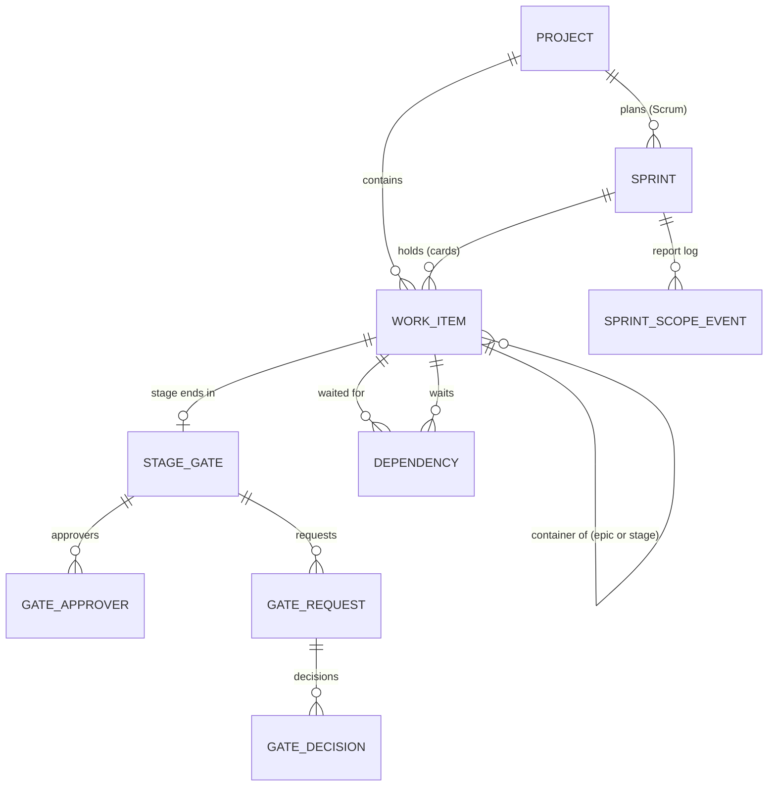

# Data Model: Templates and Planning (Phase 3)

**Feature**: [spec.md](./spec.md) | **Plan**: [plan.md](./plan.md) | **Research**: [research.md](./research.md)

Phase 3 changes the Phase 1 and Phase 2 models (`specs/002-kanban-project-core/data-model.md`,
`specs/003-project-views-and-team/data-model.md`) only by adding: one column on `Projects`, four nullable
columns on `WorkItems`, seven tables, new enum values, check constraints and indexes. No existing column
changes meaning, with one extension: in Scrum projects `WorkItems.Rank` orders cards across the whole
project instead of within one column (research R8).



## Common kernel

### ProjectTemplate (`Upms.Domain.Common`): new

`Kanban`, `Scrum`, `StageGate`. Shared by the Projects and Work modules, like `StatusCategory` (research
R2). Kanban and Scrum projects are **agile projects**.

## Projects module

### Project (`Projects`): changed

| Field | Type | Rules |
|-------|------|-------|
| Template | varchar(10) | **new**; `Kanban`, `Scrum` or `StageGate`; default `Kanban`, so every existing project becomes Kanban (FR-001, FR-004) |

**Template rules** (enforced by the `Project` aggregate):

- `Project.Create` takes the template and seeds its columns (FR-002):

  | Template | Columns (type) |
  |----------|----------------|
  | Kanban | To Do (to do), In Progress (in progress), Done (done) |
  | Scrum | To Do (to do), In Progress (in progress), In Review (in progress), Done (done) |
  | Stage-gate | Not Started (to do), In Progress (in progress), On Hold (in progress), Completed (done) |

- `Project.SwitchTemplate(target, hasOpenSprints)`: only Kanban to Scrum, and Scrum to Kanban when the
  project has no active or planned sprint; anything else is refused (`TemplateSwitchNotAllowed`,
  `SprintsOpen`). A switch increments `DetailsVersion` (the settings screen's conflict token) and keeps the
  columns (FR-005).

## Work module

### WorkItemType: new values

| Type | Level | Templates | Card | Estimate | Dates | Can change into |
|------|-------|-----------|:----:|:--------:|-------|-----------------|
| Epic | container | Kanban, Scrum | | | start and due | — |
| Stage | container | Stage-gate | | | start and due | — |
| Story | standard | Kanban, Scrum | ✅ | ✅ | start and due | Task, Bug |
| Task | standard | all | ✅ | agile only | start and due | Story, Bug (agile only) |
| Bug | standard | Kanban, Scrum | ✅ | ✅ | start and due | Story, Task |
| Milestone | standard | Stage-gate | | | due date only (its date) | — |
| Subtask | sub-task | all | | | start and due | — |

A **card** is a live, top-level Story, Task or Bug: only cards appear on boards, in the backlog and in
sprints (FR-013, research R4). Epics and milestones keep the rank `a0`; a stage's rank is its place in the
stage order (research R13).

### WorkItem (`WorkItems`): changed

| Field | Type | Rules |
|-------|------|-------|
| Type | varchar(12) | **new values** above; creation refuses types the template does not offer (`TypeNotAllowed`); changes only among Story, Task and Bug in agile projects (`TypeChangeNotAllowed`) (FR-007, FR-011) |
| ContainerId | bigint null | **new**; FK → WorkItems (restrict); only on standard items; must be a live epic or stage of the same project (`InvalidContainer`) (FR-008, FR-015) |
| Estimate | decimal(4,1) null | **new**; 0 to 999.9; only on stories, tasks and bugs of agile projects (FR-014) |
| SprintId | bigint null | **new**; FK → Sprints (restrict); only on cards of Scrum projects (FR-024) |
| Rank | varchar(64) | **extended**: in Scrum projects, one order over all of the project's cards (research R8) |

Check constraints (new):

- `CK_WorkItems_Estimate`: `Estimate IS NULL OR Estimate BETWEEN 0 AND 999.9`;
- `CK_WorkItems_Milestone`: `Type <> 'Milestone' OR (StartDate IS NULL AND Estimate IS NULL AND ParentId IS NULL)`.

**Rules**

- Every new change is recorded in the item's history and updates `UpdatedAt` and the row version, so the
  Phase 1 conflict rules apply (FR-053, FR-054): type, container, estimate and sprint changes.
- Milestones have no sub-tasks (`NoSubtasks`), no start date and no estimate (FR-012).
- Deleting a container clears `ContainerId` on its items in the same change set, each with a `Container`
  history row; a stage whose gate is approved cannot be deleted (`GateApproved`) (FR-019).
- Deleting a card in a planned or active sprint clears `SprintId` in the same change set, with a `Sprint`
  history row; in an active sprint it also writes a `Removed` scope event (research R10, R11).
- Deleting an item deletes its dependencies (and those of its sub-tasks) and records `DependencyRemoved`
  on each linked item (FR-052).
- An item that is not in a "to do" column cannot join a locked stage (FR-033).

**Derived values** (computed on read, never stored)

- **Card**: live, `ParentId` is null and `Type` is Story, Task or Bug.
- **Backlog item** (Scrum): a card that is open (`ResolvedAt` is null) and whose `SprintId` is null or
  points to a completed sprint (research R10).
- **Progress** of a container: resolved live standard items that are not milestones, out of all such
  items, with the percentage; 0% with none; 100% when the container itself is resolved (FR-017).
- **Current stage**: the first live stage by `(Rank, Id)` whose gate is not approved. **Locked stage**: a
  stage after it. An item is locked when its container is a locked stage, or, for a sub-task, when its
  parent's container is (FR-032).
- **Late dependency**: see Dependency.

### WorkItemField (history): new values

`Type`, `Container`, `Estimate`, `Sprint`, `DependencyAdded`, `DependencyRemoved`, `GateSetup`,
`GateRequested`, `GateWithdrawn`, `GateDecision`, `GateApproved`. Old and new values are display snapshots
(for example "MOB-1 Card refunds", "MOB Sprint 2"), as for statuses (Phase 1 R17). Gate rows are recorded on
the stage.

### Sprint (`Sprints`): new

| Field | Type | Rules |
|-------|------|-------|
| Id | bigint | PK |
| ProjectId | bigint | FK → Projects (restrict) |
| Number | int | 1, 2, 3… per project; unique `(ProjectId, Number)` |
| Name | nvarchar(60) | required, 1–60 characters; default "<key> Sprint <n>" (FR-023) |
| Goal | nvarchar(500) null | |
| State | varchar(10) | `Planned`, `Active` or `Completed` |
| StartDate, EndDate | date null | set when started; 2000–2099; end not before start (FR-025) |
| StartedAt, CompletedAt | datetimeoffset null | |
| CreatedAt | datetimeoffset | |
| CreatedById | uniqueidentifier | FK → Users |
| RowVersion | rowversion | concurrency token for rename, goal, start, complete and delete |

Indexes: unique `(ProjectId, Number)`; unique filtered `(ProjectId) WHERE State = 'Active'` (one active
sprint, FR-025). Check: `EndDate >= StartDate` when both are set.

**State transitions**

```text
Planned --start (dates, goal)--> Active --complete (open cards to backlog or a planned sprint)--> Completed
Planned --delete (its cards return to the backlog)--> (removed)
```

Only Project Admins and administrators change sprints (decision of 2026-09-28). A completed sprint refuses
every change (`SprintCompleted`), including cards moving into or out of it.

### SprintScopeEvent (`SprintScopeEvents`): new, append-only

| Field | Type | Rules |
|-------|------|-------|
| Id | bigint | PK |
| SprintId | bigint | FK → Sprints |
| WorkItemId | bigint | FK → WorkItems |
| Kind | varchar(12) | `Committed` (at start), `Added`, `Removed` (while active; deletion counts as removed), `Completed`, `NotCompleted` (at completion) |
| Estimate | decimal(4,1) null | the item's estimate at that moment |
| OccurredAt | datetimeoffset | |
| ActorId | uniqueidentifier | FK → Users |

Index: `(SprintId, Kind)`. The sprint report groups these rows (FR-029, research R11).

### StageGate (`StageGates`): new

| Field | Type | Rules |
|-------|------|-------|
| Id | bigint | PK |
| ProjectId | bigint | FK → Projects (restrict) |
| StageId | bigint | FK → WorkItems (a Stage); unique |
| RequiredApprovals | int null | null means all approvers; otherwise 1 to the number of approvers (FR-035) |
| ExcludeRequester | bit | default 1 (FR-035) |
| State | varchar(18) | `NotRequested`, `AwaitingDecision`, `Approved`, `SentBack` |
| CurrentRequestId | bigint null | the latest request |
| ApprovedAt | datetimeoffset null | |
| RowVersion | rowversion | |

### GateApprover (`GateApprovers`): new

`GateId` (FK), `UserId` (FK → Users), `AddedAt`, `AddedById`; key `(GateId, UserId)`.

### GateRequest (`GateRequests`): new

| Field | Type | Rules |
|-------|------|-------|
| Id | bigint | PK |
| GateId | bigint | FK → StageGates |
| Number | int | 1, 2, 3… per gate; unique `(GateId, Number)` |
| RequestedById | uniqueidentifier | FK → Users |
| RequestedAt | datetimeoffset | |
| Outcome | varchar(10) | `Pending`, `Approved`, `SentBack`, `Withdrawn`, `Cancelled` (stage deleted) |
| ClosedAt | datetimeoffset null | |
| ClosedById | uniqueidentifier null | |

### GateDecision (`GateDecisions`): new, append-only

| Field | Type | Rules |
|-------|------|-------|
| Id | bigint | PK |
| RequestId | bigint | FK → GateRequests; unique `(RequestId, ApproverId)` (one decision each) |
| ApproverId | uniqueidentifier | FK → Users |
| Decision | varchar(8) | `Approve` or `SendBack` |
| Note | nvarchar(1000) null | required for `SendBack` (FR-037) |
| DecidedAt | datetimeoffset | |

**Gate rules** (the `StageGate` aggregate, research R14):

```text
NotRequested --request--> AwaitingDecision --enough approvals--> Approved (final)
      ^                        |   |
      |                        |   +--one "send back"--> SentBack --request--> AwaitingDecision
      +------withdraw----------+
```

- Setup (approvers, the number needed, the exclusion) changes only in `NotRequested` or `SentBack`
  (`GateRequestPending`, `GateApproved`). An approver who is not a project member is added as a Viewer
  (research R16).
- A request needs: the current stage (`StageLocked` otherwise), at least one approver (`NoApprovers`), every
  approver an active member (`ApproverCannotDecide`), and enough approvers besides an excluded requester
  (`NotEnoughApprovers`). Open items in the stage produce a warning to confirm, not a refusal.
- A decision needs: a pending request with the number the approver saw (`Conflict` otherwise), the caller
  among the approvers and not the excluded requester (`Forbidden`), no earlier decision on this request
  (`AlreadyDecided`), and a note when sending back (validation).
- Approvals needed = `RequiredApprovals`, or the number of approvers when it is null.
- A stage moves into a "done" column only after approval (`GateNotApproved`).
- Deleting the current stage cancels its pending request; stages with approved gates cannot be deleted.
- Every way of creating a stage (a new Stage-gate project, the Stages view, the list's create box) creates
  its gate, and places the stage after the last stage unless the Stages view chose another allowed place.
- Restoring a deleted stage places it after the last stage and sets its gate to `NotRequested`.

### Dependency (`Dependencies`): new

| Field | Type | Rules |
|-------|------|-------|
| Id | bigint | PK |
| ProjectId | bigint | FK → Projects |
| PredecessorId | bigint | FK → WorkItems: the item **waited for** (A in "B waits for A") |
| SuccessorId | bigint | FK → WorkItems: the **waiting** item (B) |
| CreatedById | uniqueidentifier | FK → Users |
| CreatedAt | datetimeoffset | |

Indexes: unique `(PredecessorId, SuccessorId)`; `(SuccessorId)`; `(ProjectId)`. Check:
`PredecessorId <> SuccessorId`.

**Rules** (FR-047, FR-048, FR-051):

- Both items are live and in the same project; not the same item (`DependencyToSelf`); not already linked
  (`DuplicateDependency`); not within one hierarchy: container and item, parent and sub-task
  (`DependencyInHierarchy`); no loop, directly or through other items (`DependencyLoop`).
- **Late** (derived): the item waited for is open, and the waiting item's start (its start date, else its
  due date; a milestone's date) is before the due date of the item waited for. A dependency missing one of
  these dates is neither drawn nor flagged. Dates never change because of a dependency.

### Indexes

| Index | Keys | Filter | Included columns | Serves |
|-------|------|--------|------------------|--------|
| `IX_WorkItems_Board` (changed) | ProjectId, StatusId, Rank | live, top-level, **Type IN (Task, Story, Bug)** | Phase 2 columns + **Type, Estimate, SprintId** | boards, including the Scrum board |
| `IX_WorkItems_Backlog` (new) | ProjectId, Rank | live, top-level, cards | Key, Title, Type, StatusId, AssigneeId, Estimate, ContainerId, SprintId, ResolvedAt, RowVersion | the backlog (open cards), and the Scrum ranker's nearest smaller key over all cards (research R8) |
| `IX_WorkItems_Sprint` (new) | SprintId, Rank | live, `SprintId IS NOT NULL` | Key, Title, Type, StatusId, AssigneeId, Estimate, ContainerId, ResolvedAt, RowVersion | sprint lists, sprint start and completion |
| `IX_WorkItems_Container_Live` (new) | ContainerId | live, `ContainerId IS NOT NULL` | Type, StatusId, ResolvedAt | container items and progress |
| `IX_WorkItems_Project_Live` (changed) | ProjectId, Number | live | Phase 2 columns + **Type, ContainerId, Estimate** | list and timeline |
| `IX_WorkItems_Assignee_Live` (changed) | AssigneeId, ProjectId | live, assigned | Phase 2 columns + **Type** | "My tasks" |
| `IX_Dependencies_Project` (new) | ProjectId | | PredecessorId, SuccessorId | timeline arrows, loop check |
| `IX_GateRequests_Pending` (new) | GateId | `Outcome = 'Pending'` | Number, RequestedById, RequestedAt | "Gates waiting for you" |

## Identity module

### AuditEventType: new values

`ProjectTemplateChanged` (target: the project key; details: `{"From":"Kanban","To":"Scrum"}`),
`GateSetupChanged`, `GateApprovalRequested`, `GateRequestWithdrawn`, `GateDecisionRecorded` and
`GateApproved` (target: the stage key; details: approvers, number needed, exclusion, request number,
decision and note, as they apply) (FR-005, FR-040). The Projects and Work modules write them through the
new contract `IPlanningAuditLog` (research R17). Approvers added as Viewers produce the Phase 2 `MemberAdded`
event.

## Upgrade (research R24)

The Phase 3 migrations add the new tables, columns, constraints and indexes. `Projects.Template` is added
with the default `Kanban`; existing work items keep their `Task` and `Subtask` types and get no container,
estimate or sprint. No other data changes (FR-004, SC-010).
