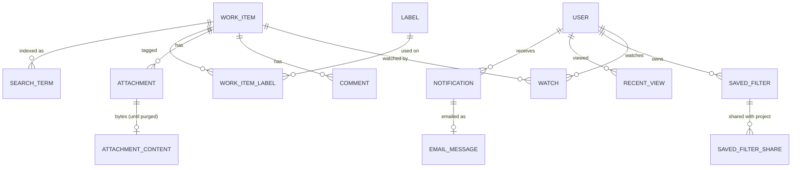

# Data Model: Collaboration and Search (Phase 4)

**Feature**: [spec.md](./spec.md) | **Plan**: [plan.md](./plan.md) | **Research**: [research.md](./research.md)

Phase 4 changes the Phase 1–3 models (`specs/002-…`, `specs/003-…`, `specs/004-…/data-model.md`) only by adding:
one column on `AspNetUsers`, three columns on `WorkItems`, two on `Comments`, eleven tables, new enum values and
indexes. No existing column changes meaning (research R4, R22).



## Identity module

### User (`AspNetUsers`): changed

| Field | Type | Rules |
|-------|------|-------|
| EmailNotifications | varchar(10) | **new**; `None`, `AimedAtMe` or `All`; not null, default `AimedAtMe` (FR-049, FR-051; research R11) |

### AuditEventType: new values

`MalwareDetected` (target: item key; details: file name, SHA-256, signature name), `AttachmentPurged` (target:
item key; details: file name, size, uploader), `EmailGivenUp` (target: recipient id; details: notification kind,
item key, attempts). Written through the new contract `IContentAuditLog` (research R20).

## Work module

### Formatted text (`Upms.Domain.Work.FormattedText`): new value object

A document in the editor's JSON form (research R3). `FormattedText.Parse(json)` returns the checked document or
a `DomainError`:

| Rule | Error code |
|------|-----------|
| Only these nodes: `doc`, `paragraph`, `heading` (level 1–3), `text`, `hardBreak`, `bulletList`, `orderedList`, `listItem`, `blockquote`, `codeBlock`, `table`, `tableRow`, `tableHeader`, `tableCell`, `mention`, `image`. Only these marks: `bold`, `italic`, `strike`, `code`, `link` | `UnsupportedFormatting` (unknown types are dropped when converting pasted content in the client; the server refuses them) |
| Every attribute not listed here is dropped: `heading.level`; `orderedList.start` (1–9999); `link.href` (`http:`, `https:` or `mailto:` only, at most 2,000 characters); `mention.id` (a user id) and `mention.label`; `image.attachmentId` and `image.alt`; `tableCell` and `tableHeader` spans are forced to 1 | `InvalidLink` for another scheme |
| Tables do not nest; a table has 1–50 rows and 1–20 columns | `UnsupportedFormatting` |
| Plain text (text nodes, with a line break between blocks) at most 32,000 characters | `TextTooLong` (field `Description` or `Body`) |
| Serialized document at most 512 KB | `TextTooLong` |

`FormattedText` exposes `PlainText`, `MentionIds` and `ImageAttachmentIds`. `FormattedTextRenderer` (in the Web
layer) turns a document into HTML, encoding every text node (research R3).

### WorkItem (`WorkItems`): changed

| Field | Type | Rules |
|-------|------|-------|
| DescriptionFormat | tinyint | **new**; `0` plain (Phase 1–3 text), `1` document; not null, default 0 (research R4) |
| DescriptionText | nvarchar(max) | **new**; the description's plain text (the text itself for plain descriptions); the migration copies `Description`; the List view's word filter uses it |

`Description` holds plain text when the format is 0 and the document's JSON when it is 1. Saving a description
now takes formatted text, records the change in history with the old and new plain text (as before), rewrites
the item's search terms, and notifies new mentions (R6, R8).

### Comment (`Comments`): changed

| Field | Type | Rules |
|-------|------|-------|
| BodyFormat | tinyint | **new**; `0` plain, `1` document; not null, default 0 |
| BodyText | nvarchar(max) | **new**; the comment's plain text; not null; the migration copies `Body` |

Phase 1 rules stay: only the author edits or deletes; deleting leaves the placeholder (FR-006). Adding a comment
makes its author a watcher (FR-011), rewrites the item's search terms, and raises the notification event.

### WorkItemField: new values

`AttachmentAdded` (new value: file name), `AttachmentRemoved` (old value: file name), `LabelAdded`, `LabelRemoved`
(value: label name) (FR-031, FR-048).

### Watch (`WorkItemWatchers`): new

| Field | Type | Rules |
|-------|------|-------|
| WorkItemId | bigint | FK → WorkItems; part of the key |
| UserId | uniqueidentifier | FK → AspNetUsers; part of the key |
| StartedAt | datetimeoffset | UTC |

- Key (`WorkItemId`, `UserId`); index (`UserId`).
- Added by the services for the creator, each commenter and each new assignee (FR-011); by the person themselves
  ("Watch"), or by a Project Admin or administrator for an active member (FR-012, FR-013). Rows stay when people
  lose access; the notification center and the lists skip people who cannot see the item (FR-014).
- The migration adds the creator, the assignee and every commenter of each existing item.

### Attachment (`Attachments`): new

| Field | Type | Rules |
|-------|------|-------|
| Id | bigint identity | key |
| WorkItemId | bigint | FK → WorkItems |
| FileName | nvarchar(255) | the uploaded name without any path, control characters removed; not empty |
| Extension | varchar(10) | lower case; one of `png`, `jpg`, `jpeg`, `gif`, `webp`, `pdf`, `doc`, `docx`, `xls`, `xlsx`, `ppt`, `pptx`, `txt`, `log`, `csv`, `json`, `xml`, `yaml`, `yml`, `md`, `sql`, `ipynb` (FR-024) |
| ContentType | varchar(100) | from the extension after the content check; images keep their image type, everything else is served as `application/octet-stream` |
| Size | int | 1 byte to 26,214,400 bytes (25 MB) |
| Sha256 | binary(32) | hash of the content |
| UploadedById | uniqueidentifier | FK → AspNetUsers |
| UploadedAt | datetimeoffset | UTC |
| CheckStatus | varchar(10) | `Checking`, `Passed` or `Blocked` |
| CheckAttempts | int | scans tried |
| NextCheckAt | datetimeoffset | when the scan worker tries next; null once checked |
| CheckedAt | datetimeoffset | nullable |
| ThreatName | nvarchar(200) | nullable; the scanner's signature name when blocked |
| RemovedAt, RemovedById | datetimeoffset, uniqueidentifier | nullable; set when removed from the item (FR-028) |
| PurgedAt, PurgedById | datetimeoffset, uniqueidentifier | nullable; set when an administrator deletes it permanently (FR-029) |
| RowVersion | rowversion | concurrency |

- Indexes: (`WorkItemId`) filtered to `RemovedAt IS NULL AND PurgedAt IS NULL`; (`NextCheckAt`) filtered to
  `CheckStatus = 'Checking'` for the scan worker.
- A file is downloadable only when `CheckStatus = 'Passed'`, it is neither removed nor purged, its item is not
  deleted, and the person can see the item (FR-025, FR-027, FR-030).

**States**:

```text
Checking ──clean──▶ Passed
   │  └──infected──▶ Blocked (quarantined: bytes kept but never served; threat recorded; uploader notified; audit MalwareDetected)
   └──scanner unavailable──▶ Checking (retried after 1, 5, then every 15 minutes)
Checking | Passed ──uploader (while contributor), Project Admin or administrator──▶ Removed (bytes kept for audit; history)
any ──administrator──▶ Purged (bytes deleted; audit AttachmentPurged)
```

### AttachmentContent (`AttachmentContents`): new

| Field | Type | Rules |
|-------|------|-------|
| AttachmentId | bigint | key; FK → Attachments (cascade delete) |
| Content | varbinary(max) | the file; written and read as a stream (research R12) |

Deleted only when an administrator purges the file; a blocked file's content stays in quarantine until then.

### Label (`Labels`): new

| Field | Type | Rules |
|-------|------|-------|
| Id | int identity | key |
| Name | nvarchar(50) | the first spelling used; 1–50 characters, no whitespace, control characters or commas (FR-042) |
| NormalizedName | nvarchar(50) | upper-cased (invariant culture); unique (FR-043) |

### WorkItemLabel (`WorkItemLabels`): new

| Field | Type | Rules |
|-------|------|-------|
| WorkItemId | bigint | FK → WorkItems; part of the key |
| LabelId | int | FK → Labels; part of the key |
| AddedAt, AddedById | datetimeoffset, uniqueidentifier | who added it |

- Key (`WorkItemId`, `LabelId`); index (`LabelId`) including `WorkItemId`. At most 20 labels per item (FR-042).
- Suggestions: labels with at least one row on a live item in a project the person can access, whose normalized
  name starts with the typed text (FR-044).

### SearchTerm (`SearchTerms`): new

| Field | Type | Rules |
|-------|------|-------|
| WorkItemId | bigint | FK → WorkItems; part of the key |
| Term | nvarchar(40) | a lower-cased word of 2–40 characters from the title, the description's plain text or a live comment's plain text; part of the key |
| ProjectId | bigint | copied from the item, for the access filter |

Key (`WorkItemId`, `Term`); index (`Term`) including `ProjectId` and `WorkItemId`. Rewritten for the item in the
same transaction as a title, description or comment change (research R15).

### SearchIndexProgress (`SearchIndexProgress`): new

| Field | Type | Rules |
|-------|------|-------|
| Id | int | key; always 1 (one row) |
| LastWorkItemId | bigint | every item up to this id has been looked at by `SearchIndexWorker` |

The worker reads the row under a lock, indexes the next 500 items by id that have no words yet, and moves the row
on, so indexing never writes to `WorkItems` and never changes an item's version. Setting it to 0 makes the worker
look at every item again.

### SavedFilter (`SavedFilters`): new

| Field | Type | Rules |
|-------|------|-------|
| Id | bigint identity | key |
| OwnerId | uniqueidentifier | FK → AspNetUsers |
| Name | nvarchar(80) | 1–80 characters |
| NormalizedName | nvarchar(80) | unique per owner (FR-039) |
| Query | nvarchar(2000) | the search page's canonical query string (words, filters, sort) |
| CreatedAt, UpdatedAt | datetimeoffset | UTC |
| RowVersion | rowversion | concurrency (rename and update) |

### SavedFilterShare (`SavedFilterShares`): new

| Field | Type | Rules |
|-------|------|-------|
| SavedFilterId | bigint | FK → SavedFilters (cascade delete); part of the key |
| ProjectId | bigint | FK → Projects; part of the key; the owner must be a member (or an administrator) when sharing |
| SharedAt | datetimeoffset | UTC |

Index (`ProjectId`). A share counts only while the owner is active and a member of the project (or an
administrator), checked on read
(FR-040; research R17).

### RecentView (`RecentViews`): new

| Field | Type | Rules |
|-------|------|-------|
| UserId | uniqueidentifier | part of the key |
| WorkItemId | bigint | FK → WorkItems; part of the key |
| ViewedAt | datetimeoffset | updated when the person opens the item's drawer |

Index (`UserId`, `ViewedAt` descending). Trimmed to the latest 50 per person (FR-033).

## Notifications module

### Notification (`Notifications`): new

| Field | Type | Rules |
|-------|------|-------|
| Id | bigint identity | key |
| RecipientId | uniqueidentifier | FK → AspNetUsers |
| Kind | varchar(20) | `Assigned`, `Mentioned`, `Commented`, `StatusChanged`, `ApprovalRequested`, `GateDecided`, `UploadBlocked` (FR-015, FR-016) |
| ProjectId | bigint | for the visibility check on read |
| WorkItemId | bigint | the item, or the stage for gate events |
| ActorId | uniqueidentifier | nullable; null only for `UploadBlocked` (the system) |
| Detail | nvarchar(200) | nullable; the new status name, the gate outcome ("Approved" or "Sent back"), or the blocked file's name |
| OccurredAt | datetimeoffset | UTC |
| ReadAt | datetimeoffset | nullable; null means unread |

- Indexes: (`RecipientId`, `ReadAt`, `OccurredAt` descending) including `ProjectId`; (`OccurredAt`) for the daily
  clean-up.
- One row per recipient per action; the actor is never a recipient (FR-017). Read and listed only by the
  recipient, and only while they can access the item's project; notifications about deleted items stay listed
  (research R8). Deleted after 90 days (FR-021).

**Reasons and email choices** (research R11):

| Kind | Reason | Emailed for `AimedAtMe` | Emailed for `All` |
|------|--------|:-----------------------:|:-----------------:|
| Assigned | someone else assigned the item to the recipient | ✅ | ✅ |
| Mentioned | someone else mentioned the recipient for the first time in a text | ✅ | ✅ |
| Commented | someone else commented on an item the recipient watches | — | ✅ |
| StatusChanged | someone else changed the status of an item the recipient watches | — | ✅ |
| ApprovalRequested | approval was requested of a gate the recipient approves and may decide on | ✅ | ✅ |
| GateDecided | the recipient's gate request was approved or sent back | ✅ | ✅ |
| UploadBlocked | the recipient's upload was blocked by the malware check | ✅ | ✅ |

Precedence when one action gives a person several reasons: Mentioned, then Assigned, then Commented or
StatusChanged.

### EmailMessage (`EmailMessages`): new

| Field | Type | Rules |
|-------|------|-------|
| Id | bigint identity | key |
| NotificationId | bigint | FK → Notifications; the email's content is built from it at send time |
| RecipientId | uniqueidentifier | the address is read from the account when sending |
| CreatedAt | datetimeoffset | UTC; the 24-hour retry window starts here |
| Attempts | int | sends tried |
| NextAttemptAt | datetimeoffset | due time |
| LockedUntil | datetimeoffset | nullable; set while a worker instance is sending it |
| SentAt | datetimeoffset | nullable |
| GivenUpAt | datetimeoffset | nullable; set after 24 hours without delivery (audit `EmailGivenUp`) |
| CancelledAt | datetimeoffset | nullable; the recipient was deactivated before sending |
| LastError | nvarchar(500) | nullable; never contains message content |

- Index (`NextAttemptAt`) filtered to `SentAt IS NULL AND GivenUpAt IS NULL AND CancelledAt IS NULL`.
- Created in the same transaction as its notification, only if the recipient's choice includes the kind and
  email is configured (research R10). Rows finished more than 30 days ago are deleted with old notifications.

**States**:

```text
Pending ──sent──▶ Sent
   │ └──recipient deactivated──▶ Cancelled
   └──send failed──▶ Pending (retry after 1, 2, 5, 10, 20, then every 30 minutes)
                        └──24 hours after creation──▶ GivenUp (audit EmailGivenUp)
```

## Enumerations

| Enum | Values | Module |
|------|--------|--------|
| `EmailChoice` | `None`, `AimedAtMe`, `All` | shared (`Upms.Domain.Common`): kept by Identity, applied by Notifications |
| `TextFormat` | `Plain` (0), `Document` (1) | Work |
| `AttachmentCheckStatus` | `Checking`, `Passed`, `Blocked` | Work |
| `NotificationKind` | `Assigned`, `Mentioned`, `Commented`, `StatusChanged`, `ApprovalRequested`, `GateDecided`, `UploadBlocked` | Notifications (`Upms.Domain.Notifications`) |
| `WorkItemField` | + `AttachmentAdded`, `AttachmentRemoved`, `LabelAdded`, `LabelRemoved` | Work |
| `AuditEventType` | + `MalwareDetected`, `AttachmentPurged`, `EmailGivenUp` | Identity |

## Migrations (research R22)

1. `Notifications` (foundation): `Notifications`.
2. `FormattedTextAndWatchers` (story 1): `DescriptionFormat`, `DescriptionText` (copied from `Description`),
   `BodyFormat`, `BodyText` (copied from `Body`), `WorkItemWatchers` (backfilled from creators, assignees and
   commenters).
3. `Attachments` (story 2): `Attachments`, `AttachmentContents`.
4. `SearchAndSavedFilters` (story 3): `SearchTerms`, `WorkItems.SearchIndexedAt` (dropped again by migration 7),
   `SavedFilters`, `SavedFilterShares`, `RecentViews`.
5. `Labels` (story 4): `Labels`, `WorkItemLabels`.
6. `EmailOutbox` (story 5): `EmailMessages`, `AspNetUsers.EmailNotifications`.
7. `SearchIndexProgress` (found while validating): `SearchIndexProgress`, replacing `WorkItems.SearchIndexedAt`, so
   background indexing never changes an item's version.
