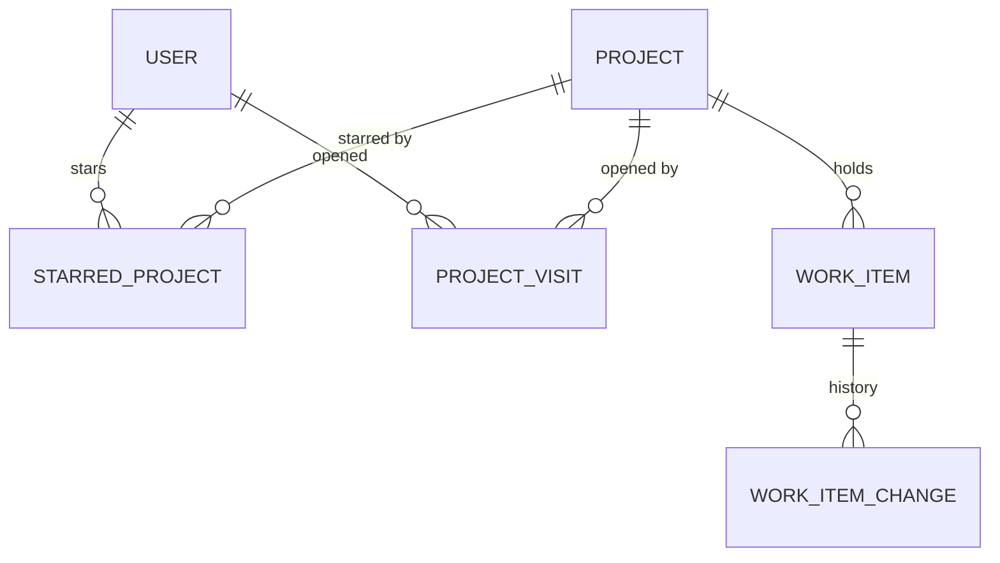

# Data Model: Jira Parity Pass

**Feature**: [spec.md](./spec.md) | **Plan**: [plan.md](./plan.md) | **Research**: [research.md](./research.md)

This pass changes the Phase 1–4 models (`specs/002-…` to `specs/005-…/data-model.md`) only by adding:
- one column on `AspNetUsers`, one on `Projects` and one on `WorkItems`;
- two tables;
- new enum values;
- three indexes.

No column changes meaning, and tables and code keep the name "project" (research R1).

## Identity module

### User (`AspNetUsers`): changed

| Field | Type | Rules |
|-------|------|-------|
| SidebarCollapsed | bit | **new**; not null, default 0; the person's choice, applied above 768 px (FR-021; research R5) |

`MyProfile` gains `SidebarCollapsed`. `IAccountService.SetSidebarCollapsedAsync(bool)` saves it for the signed-in
person.

### AuditEventType: new value

`ProjectWorkTypesChanged` (target: space key; details: the work types before and after), written by the Projects
module (research R14).

## Projects module

### Project (`Projects`): changed

| Field | Type | Rules |
|-------|------|-------|
| WorkTypes | int | **new**; not null, default 15; a `WorkTypeSet` (Epic 1, Story 2, Task 4, Bug 8); at least one of Story, Task or Bug; ignored by Stage-gate spaces (FR-016, FR-017; research R14) |

New rules on `Project`:

| Method | Rule | Error code |
|--------|------|-----------|
| `Create(name, key, description, owner, now, template, columns, workTypes)` | the Blank template: Kanban, with 1–10 columns (names 1–30 characters after trimming, unique ignoring case), at least one To do and one Done, in the order given | `TooManyColumns`, `DuplicateColumnName`, `LastToDoColumn`, `LastDoneColumn`, validation on `Columns[i].Name` |
| `Create(…)` and `SetWorkTypes(set, typesInUse, now)` | at least one of Story, Task or Bug | `NoStandardType`: "Choose at least one of Story, Task or Bug." |
| `SetWorkTypes` | a type being turned off is not used by any live or deleted item of the space | `WorkTypeInUse`: "Bugs are still used by 4 items in this space." |
| `SetWorkTypes` | not on Stage-gate spaces | `TemplateSwitchNotAllowed` reused: "Stage-gate spaces have fixed work types." |
| `SetWorkTypes` | bumps `DetailsVersion`; a stale version is `Conflict` | — |
| `SwitchTemplate` | keeps `WorkTypes` | — |

### WorkTypeSet (`Upms.Domain.Common`): new flags enum

`Epic = 1, Story = 2, Task = 4, Bug = 8, All = 15`. `WorkItemTypes.IsOffered(type, template, set)`:
- Kanban and Scrum spaces offer Sub-task always, and Epic, Story, Task and Bug when their flag is on;
- Stage-gate spaces offer Stage, Task, Milestone and Sub-task, as in Phase 3.

### StarredProject (`StarredProjects`): new

| Field | Type | Rules |
|-------|------|-------|
| UserId | uniqueidentifier | PK part; FK to `AspNetUsers` |
| ProjectId | bigint | PK part; FK to `Projects` (cascade delete) |
| StarredAt | datetimeoffset | UTC |

Personal. It is read only through the spaces the person can see now (research R6).

### ProjectVisit (`ProjectVisits`): new

| Field | Type | Rules |
|-------|------|-------|
| UserId | uniqueidentifier | PK part; FK to `AspNetUsers` |
| ProjectId | bigint | PK part; FK to `Projects` (cascade delete) |
| VisitedAt | datetimeoffset | UTC; index (UserId, VisitedAt DESC) |

At most 20 rows per person: recording a visit deletes the older ones. Read only through the spaces the person can
see now.

## Work module

### WorkItem (`WorkItems`): changed

| Field | Type | Rules |
|-------|------|-------|
| Color | tinyint | **new**; null except for epics; 0–7 (`EpicColor`: Purple, Blue, Teal, Green, Yellow, Orange, Red, Gray); a new epic takes `(Number − 1) mod 8`; existing epics are given the same in the migration (FR-025; research R15) |

New rule: `WorkItem.SetColor(EpicColor, context)` applies to epics only (`ColorNotAllowed`). It writes a history entry
(`WorkItemField.Color`, old and new color names).

### NewWorkItem (application record): changed

Optional fields added for the Create form (FR-004–FR-006; research R11). Each follows the same rule as its drawer
edit:

| Field | Rule |
|-------|------|
| ParentKey | required for Sub-task (`ParentRequired`: "Choose the item this sub-task belongs to."), a live Story, Task or Bug of the same space (`InvalidParent`: "The parent item no longer exists.") |
| ContainerKey | as Phase 3 (an epic, or a stage in Stage-gate spaces), standard items only |
| Description | the editor's JSON document, as the drawer (Phase 4 FR-001, FR-002) |
| StatusId | one of the space's columns; default the first To do column; stage lock (Phase 3 FR-033) |
| AssigneeId | an active Space admin or Member (`NotAssignable`) |
| Priority | default Medium |
| Labels | up to 20, label rules (Phase 4 FR-042) |
| SprintId | Scrum stories, tasks and bugs; an active or planned sprint (`SprintClosed`) |
| StartDate, DueDate | `InvalidDates`; milestones take one date (Phase 3) |
| Estimate | agile stories, tasks and bugs; 0–999.9 (Phase 3 FR-014) |

### WorkItemField: new value

`Color`.

### Error codes: new

`ParentRequired`, `InvalidParent`, `NoStandardType`, `WorkTypeInUse`, `ColorNotAllowed`, `SubtaskFollowsParent`.

### LaneChange (application record): new

`LaneChange.Container(string? ContainerKey)` or `LaneChange.Assignee(Guid? UserId)`, with a card move
(`IBoardService.MoveCardAsync`; research R17).

### Board reads: changed

`CardView` gains `ParentKey` (for sub-tasks) and `ContainerColor`. `ContainerView` gains `Color`. Sub-task cards
take their parent's container (research R18).

## Indexes

| Index | Table | Definition | Used by |
|-------|-------|------------|---------|
| `IX_WorkItemChanges_Actor` | WorkItemChanges | (ActorId, OccurredAt) INCLUDE (WorkItemId, Field) | For you "Worked on"; the Create form's default space (R9, R10) |
| `IX_WorkItemChanges_OccurredAt` | WorkItemChanges | (OccurredAt) INCLUDE (WorkItemId, ActorId, Field) | Summary "Recent activity" (R8) |
| `IX_WorkItems_Summary` | WorkItems | (ProjectId) INCLUDE (Type, Priority, StatusId, AssigneeId, ContainerId, ParentId, CreatedAt, UpdatedAt, ResolvedAt, DueDate) WHERE IsDeleted = 0 | Summary counts and breakdowns (R8) |

## Migrations

1. `WorkTypesAndActivityIndex`: `Projects.WorkTypes` (default 15 for every existing space);
   `IX_WorkItemChanges_Actor`.
2. `SpaceNavigation`: `StarredProjects`, `ProjectVisits`, `AspNetUsers.SidebarCollapsed`,
   `IX_WorkItemChanges_OccurredAt`, `IX_WorkItems_Summary`.
3. `EpicColors`: `WorkItems.Color`; `UPDATE WorkItems SET Color = (Number - 1) % 8 WHERE Type = 'Epic'` (an
   ordinary table; history is not touched).
